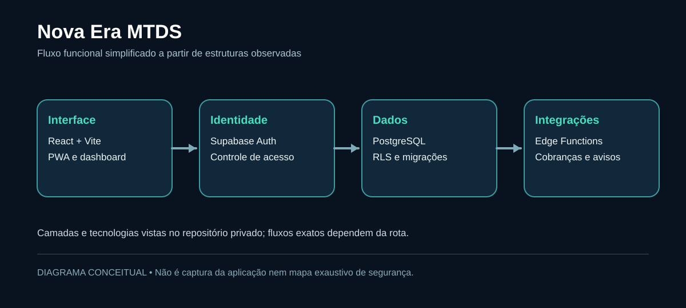
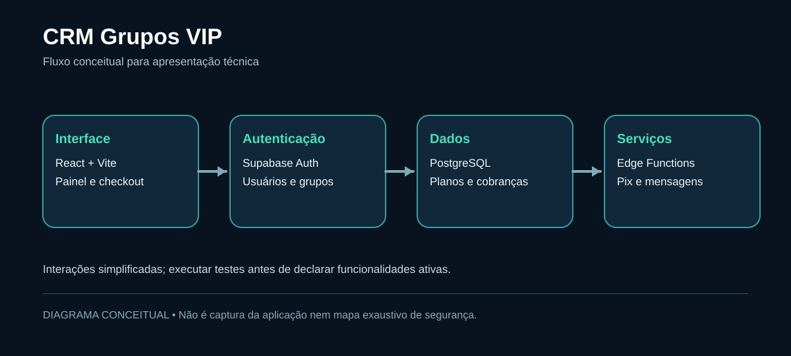

# Roger Machado

**Desenvolvedor Full-Stack | React · TypeScript · Node.js · PostgreSQL/Supabase**  
**Em especialização:** engenharia de aplicações com IA, LLMs, RAG e agentes — *formação em andamento, não experiência profissional declarada.*

📍 Nova Iguaçu, RJ · [LinkedIn](https://www.linkedin.com/in/roger-machado-dev/) · [E-mail](mailto:rogermachado019@gmail.com)

Desenvolvo aplicações web de ponta a ponta, conectando interface, autenticação, banco de dados e integrações. Interesso-me por arquitetura, segurança por padrão e evolução de produtos em produção.

## Projetos que você pode avaliar

| Projeto | Evidência técnica | Repositório / estudo |
|---|---|---|
| **Barber Flow** | SaaS de agendamento multi-tenant, RLS, testes Vitest e GitHub Actions. Projeto de estudo. | [Código público](https://github.com/itsrogermachado/barber-flowss) |
| **FloatPacks** | Next.js 15, React 19, catálogo e carrinho persistente com Zustand. Projeto de estudo. | [Código público](https://github.com/itsrogermachado/floatpacks) |
| **RKPODS** | React, TypeScript, Supabase, controle de pedidos e estoque por região. | [Código público](https://github.com/itsrogermachado/rkpods) |
| **Nova Era MTDS** | Dashboard/PWA e arquitetura React + Supabase + PostgreSQL + Edge Functions. | [Estudo de caso](docs/cases/nova-era-mtds.md) · [Site público](https://novaeramtds.com) |
| **CRM Grupos VIP** | Gestão de assinaturas, Pix, vencimentos, administração e integrações. Código privado. | [Estudo de caso](docs/cases/crm-grupos-vip.md) |

## Arquitetura e decisões técnicas

Os diagramas abaixo são **conceituais**. Não são prints, benchmarks nem auditorias completas.

## Meu foco de evolução: IA aplicada à engenharia de software

Estou estudando integração de LLMs com aplicações reais, ferramentas, RAG, avaliações, segurança e observabilidade. O objetivo é publicar um projeto demonstrável com conjunto de testes e métricas reprodutíveis.

- [Roteiro prático de 8 semanas](docs/estudos/roteiro-ia-8-semanas.md)
- [Perguntas de entrevista e matriz de evidências](docs/entrevistas/perguntas-e-evidencias.md)

## Tecnologias e estudos

**Front-end:** React, TypeScript, JavaScript, Next.js, Vite e Tailwind CSS  
**Back-end e dados (projetos):** Node.js, Supabase Auth, PostgreSQL, RLS e Edge Functions  
**Linguagens de back-end que estou estudando:** **Python e Java**  
**Qualidade e ferramentas:** Git, GitHub Actions, Vitest, Playwright e Docker (conforme os projetos)  
**Em aprofundamento:** integração de LLMs, RAG, agentes de IA e desenvolvimento de aplicações com inteligência artificial

Busco evoluir tanto na construção de sistemas full-stack quanto nos fundamentos de back-end com **Java e Python**, aplicando esse aprendizado em projetos práticos.

> Projetos privados não são expostos para preservar código e dados de clientes. Métricas de receita, quantidade de usuários e disponibilidade só serão publicadas quando houver comprovação.
